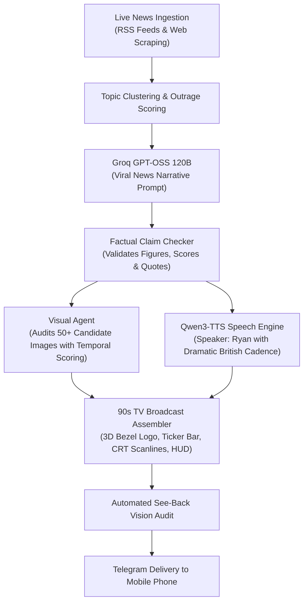

# ⚽ Football in 30 Seconds — Autonomous Video Studio

An end-to-end autonomous video production pipeline designed for high-retention YouTube Shorts, Instagram Reels, and TikTok. 

Engineered with authentic **90s TV sports broadcast aesthetics**, **Groq LPUs running OpenAI GPT-OSS 120B**, **legendary Martin Tyler cloned commentator voiceover (Qwen3-TTS Base)**, and **remote Telegram mobile control**.

---

## 🚀 Quick Setup (1-Click on Windows)

Anyone can clone and run their own autonomous studio in less than 3 minutes:

### 1. Prerequisites
- **Windows 10 / 11**
- **Python 3.10 or 3.11** (Ensure *"Add Python to PATH"* is checked during installation)
- **FFmpeg** installed on system PATH (`winget install Gyan.FFmpeg`)
- *(Optional)* NVIDIA GPU with CUDA for ultra-fast speech synthesis & vision models.

### 2. Launch
Double-click:
```cmd
setup_and_run.bat
```
The automated script will:
1. Create a clean isolated virtual environment (`.venv`).
2. Auto-detect your GPU and install CUDA PyTorch or CPU PyTorch.
3. Install all required dependencies from `requirements.txt`.
4. Prompt you for 3 quick fields to connect your phone:
   - **Telegram Bot Token**: Get free from [@BotFather](https://t.me/botfather).
   - **Telegram Chat ID**: Get from [@userinfobot](https://t.me/userinfobot).
   - **Groq API Key**: Free high-speed LPU key from [console.groq.com](https://console.groq.com/keys).
5. Auto-download official Alibaba **Qwen3-TTS** neural weights with resumable IPv4 streaming.
6. Launch the background studio service daemon.

---

## 📱 Mobile Telegram Studio Control

Once `setup_and_run.bat` is running on your computer, you can close your laptop's lid (or leave it in the background) and control everything directly from Telegram on your phone:

| Command | Action |
| :--- | :--- |
| **`/new`** | Scans top sports news feeds, clusters trending topics, and generates a fresh viral 90s TV Short |
| **`[Paste any news URL]`** | Instantly scrapes the article and transforms it into a complete multi-scene video |
| **`/status`** | Displays active rendering progress, laptop VRAM, and RAM utilization |
| **`/cancel`** | Aborts and archives any running cycle |
| **`/help`** | Displays the full tactical studio command manual |

The bot features **real-time in-place progress bars** (`[██████░░░░] 60% — Auditing Visuals...`) with zero notification spam.

---

## 🧠 Pipeline Architecture



### Key Technical Components:
1. **Viral Narrative Generator (`stages/script_generator.py`)**:
   - Executes the Director's `# SYSTEM PROMPT: VIRAL NEWS NARRATIVE GENERATOR`.
   - Aggressive 3-second hook, staccato tension building, tactical satire (Ancelotti bench jokes), and strictly terminates with a binary debate question: `YES OR NO? Comment below!`.
2. **Commentary Speech Engine (`stages/martin_tyler_synthesizer.py`)**:
   - High-energy Martin Tyler zero-shot voice cloning powered by `Qwen3-TTS-12Hz-0.6B-Base`.
   - In-context learning (ICL) prompt caching for instant generation without voice drift.
   - Pacing and mastering chain: 1.14x tempo, 80Hz rumble filter, 3.2kHz vocal presence EQ, broadcast compander, and EBU R128 loudness normalization (-14 LUFS).
   - Graceful failover to `stages/tts_synthesizer.py` (Edge-TTS and Kokoro ONNX).
3. **Temporal Visual Auditor (`stages/visual_agent.py`)**:
   - Audits 50+ candidate images across Bing, Wikimedia, and Wikipedia REST.
   - Intelligent temporal scoring: rewards modern 2024–2026 press conference kits for breaking news; awards vintage bonuses for retrospective legends stories.
4. **90s TV Broadcast Compositor (`stages/video_assembler.py`)**:
   - Authentic 90s graphics package: 3D ticker tape, glowing live indicator, authentic CRT scanlines, and beveled corner TV bug.
   - Midnight radial studio spotlight outro with dramatic whoosh zoom on the channel logo.

---

## 🛠️ Project Structure

```text
football-video-pipeline/
├── pipeline/                      # Service orchestrator & state manager
│   ├── orchestrator.py            # Main multi-stage execution pipeline
│   ├── state_manager.py           # SQLite job state & recovery (WAL mode)
│   └── resource_monitor.py        # CPU/VRAM usage tracking
├── stages/                        # Modular pipeline stages
│   ├── script_generator.py        # GPT-OSS 120B viral scriptwriter
│   ├── martin_tyler_synthesizer.py# Martin Tyler cloned commentator voice
│   ├── tts_synthesizer.py         # Multi-engine speech synthesis & mastering
│   ├── visual_agent.py            # 50+ candidate image auditing engine
│   ├── video_assembler.py         # 90s TV broadcast video compositor
│   ├── telegram_bot.py            # Telegram bot interface with progress bars
│   └── download_qwen3_base.py     # Resumable model weights downloader
├── tests/                         # Automated test suites
│   ├── test_claim_checker.py      # Grounding, numbers & private life tests
│   ├── test_state_machine.py      # SQLite WAL & crash recovery tests
│   └── test_json_resilience.py    # LLM formatting & JSON resilience tests
├── data/                          # Branding templates, fonts, SFX, and media
│   ├── branding/                  # Master beveled logos & voice reference audio
│   ├── fonts/                     # Broadcast typography
│   ├── retro_90s/                 # CRT scanline overlays
│   └── sfx/                       # Whoosh zooms & broadcast sound effects
├── config/                        # Configuration files
│   └── config.yaml                # Pipeline feeds & video configuration
├── requirements.txt               # Production Python dependencies
├── setup_and_run.bat              # 1-click Windows setup wizard
└── run_pipeline_service.py        # Standalone background daemon
```

---

## 📄 License
Apache-2.0 License. Designed for creators, media agencies, and automated sports networks.
