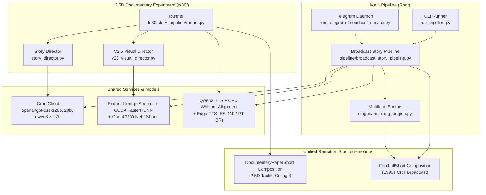

# System Architecture — 30 Football Plus & FS30 Studio

## 1. Dual-Engine Overview

This repository hosts a promoted main broadcast news production engine at the repository root alongside the preserved `fs30/` 2.5D experimental documentary engine. Both share `stages/` AI/vision/TTS modules, local `models/`, `config/config.yaml`, and the unified `remotion/` rendering workspace.

---

## 2. Main Broadcast Pipeline (`pipeline/`, `stages/`, `remotion/`)

### Editorial & Script Generation
- **Feed Ingestion & Ranking**: Polls Google News Transfers, Transfermarkt, Football Italia, BBC Sport, Sky Sports, The Guardian, ESPN APIs, Bing News, and Reddit (`config/config.yaml`, `stages/collector.py`, `stages/ranker.py`).
- **Fact Checking**: `stages/fact_checker.py`, `stages/source_verifier.py`, `stages/claim_mapper.py`, and `stages/editorial_policy.py` ground player, club, stadium, and manager entities and enforce source tiers before rendering.
- **Screenplay Envelope (`pipeline/neural_instructions.py`)**: 8-scene vertical format (`S01..S07` + `outro`):
  - `S01` enforces protagonist concealment (anonymous setup hook).
  - `S02` reveals the protagonist explicitly.
  - `S07` frames an `OR` / `AND` closing fan dilemma driving dual visual panels.
  - Tight per-beat word budget (~7–10 words/scene, total ~30–34s rendered runtime).

### Visual Sourcing & Identity Verification
- **Multi-Source Retrieval**: `stages/editorial_image_sourcer.py` & `stages/image_sourcing.py` query ESPN, news `og:image`, Wikipedia, Wikimedia, Bing full-res, and social editorial sources with watermark/domain blocklists and perceptual dHash deduplication.
- **Computer Vision Gate (`stages/semantic_image_procurement.py`, `stages/action_aware_cropper.py`)**:
  - CUDA FasterRCNN object detection verifies player/ball context and rejects standing mugshots when action is requested.
  - OpenCV YuNet + SFace embeddings verify face identity against Wikipedia reference embeddings (`data/face_cache/`).
  - Supports vertical portrait crops, landscape/dual-landscape split placement, and club crest/stadium visuals.

### Voiceover, Mastering & Localization
- **English Anchor (`stages/production_voice_engine.py`, `stages/qwen_tts_synthesizer.py`)**: High-energy breaking news presenter (`Aiden` profile) rendered in cohesive takes, sliced and aligned via Whisper, mastered with broadcast EQ and `-14.0 LUFS` EBU R128 loudness normalization.
- **Spanish & Portuguese (`stages/multilang_engine.py`, `execute_multilang_production.py`)**:
  - `es-419`: `es-MX-JorgeNeural` (Latin American Spanish; excludes Spain `vosotros` forms).
  - `pt-BR`: `pt-BR-AntonioNeural` (Brazilian Portuguese).
  - Syllable-budgeted translation (`6–8` words per beat) prevents romance-language runtime inflation.

### Remotion Broadcast Composition (`remotion/src/FootballShort.tsx`)
- `1080x1920`, `30fps` timeline with **Barlow Condensed**, **Inter**, and **IBM Plex Mono** (`config/typography.ts`, `assets/fonts/`).
- 1990s Sony Trinitron CRT aesthetic (`BackgroundMedia.tsx`, `RetroOverlay.tsx`) applied only to footage/backgrounds while keeping HUD (`TopHUD.tsx`), subtitles (`SubtitleCard.tsx`), lower-thirds, rolling ticker (`RollingTicker.tsx`), and outro crisp.

---

## 3. Preserved 2.5D Documentary Experiment (`fs30/`)

`fs30/` remains self-contained at its original path and reuses shared root services:
- **`fs30/story_pipeline/story_director.py`**: Grounded via Wikipedia REST search (`_fetch_grounding_context`) + two-pass Groq `json_mode=True` authoring restricted to `openai/gpt-oss-120b` and `qwen/qwen3.8-27b` with sarcastic British dry-wit writing across 8 alternating visual layouts (`vox_25d_cutout`, `newspaper_highlighter`, `full_bleed_callout`, `archival_pinboard`, `kinetic_quote_card`, `puppet_confrontation_25d`, `tactile_timeline_card`, `clean_editorial_epilogue`).
- **`fs30/story_pipeline/v25_visual_director.py`**: Extracts `rembg` paper-sticker cutouts (`>= 320x430`, `top_luma >= 46`, `matched_fh >= 44`), rejects synthetic thumbnails/watermarks (`_check_synthetic_card`), generates paper headlines, torn quote cards, and highlighter bounding boxes (`paper_widgets.py`, `photo_mounter.py`).
- **`fs30/story_pipeline/runner.py` & `audio_engine.py`**: Synthesizes cohesive multi-beat voice blocks via `qwen3_tts_base` cloned from `models/cumberbatch_clean_ref.wav`, slices via CPU Whisper word timestamps, strips all whoosh/swoosh SFX, and renders `DocumentaryPaperShort` with OFL fonts (**Anton**, **Playfair Display**, **Special Elite**, **Space Mono**, **Syne**) at `12fps` stepped paper-boil + `30fps` parallax.

---

## 4. Legacy Git Archive (`legacy` & `legacy-v1`)

Before promoting `/beta` into the root main pipeline and pruning V1 root files / sandbox throwaway scripts:
- Git tag **`legacy-v1`** (`9e0dd43`) preserves the full original V1 root pipeline (`stages/`, `pipeline/`, `remotion/`, `run.py`).
- Git branch **`legacy`** (`983012e`) preserves the exact pre-promotion repository snapshot with `/beta` isolated alongside root wrappers.
- Both refs are pushed to `origin`.
